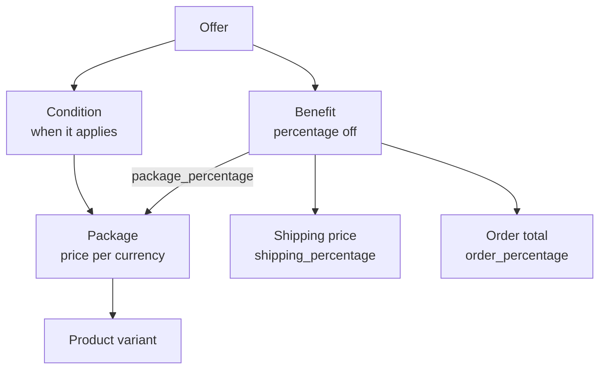

import { Callout } from 'fumadocs-ui/components/callout';

Use the Admin API to set up and manage campaigns from a server or an AI agent instead of the dashboard. It covers campaigns, packages, offers, and shipping methods, and returns the `api_key` your funnel pages use.

<Callout type="warn" title="Never Call the Admin API From a Campaign Page">
Admin API tokens have full access to your store, so keep them on a server. Funnel pages call the [Campaign Cart API](/docs/campaigns/api) with a per-campaign key, the only credential safe to ship in browser code.
</Callout>

## Permissions

| Scope | Needed to |
| --- | --- |
| `campaigns:read` | Read campaigns and their packages, offers, and shipping methods |
| `campaigns:write` | Create, update, and delete campaigns and their packages, offers, and shipping methods |
| `catalogue:read` | Look up the `product_id` and `product_variant_ids` for a package with [productsList](/docs/admin-api/reference/products/productsList) and [productsVariantList](/docs/admin-api/reference/products/productsVariantList) |
| `gateways:read` | Read gateway groups and their payment method codes with [gatewayGroupsList](/docs/admin-api/reference/payments/gatewayGroupsList) |
| `shipping_methods:read` | Read the store's shipping method codes with [shippingMethodsList](/docs/admin-api/reference/fulfillment/shippingMethodsList) |

See [Admin API permissions](/docs/admin-api/permissions) for every scope and [Admin API → Getting Started](/docs/admin-api) to create an OAuth app.

<Callout type="info" title="Only Available on 2024-04-01 API Version">
Campaign endpoints need API version `2024-04-01` or later.
</Callout>

## Campaign Provisioning Flow

1. Get the gateway group `id` and its payment methods from [gatewayGroupsList](/docs/admin-api/reference/payments/gatewayGroupsList).
2. Create the campaign with [campaignsCreate](/docs/admin-api/reference/campaigns/campaignsCreate).
3. Add a package for each sellable item with [campaignsPackagesCreate](/docs/admin-api/reference/campaigns/campaignsPackagesCreate).
4. Add offers with [campaignsOffersCreate](/docs/admin-api/reference/campaigns/campaignsOffersCreate).
5. Configure your funnel pages with the `api_key` from the create response.

### Create a Campaign

`name`, `currency`, `language`, and `payment_gateway_group_id` are required. This example is a US English campaign that also accepts CAD.

```json title="Create Campaign" http-method="POST" http-target="https://{store}.29next.store/api/admin/campaigns/"
{
  "name": "Spring Widget Launch US", // internal reference name
  "currency": "USD", // default currency for orders on this campaign
  "language": "en", // preferred customer language
  "payment_gateway_group_id": 4, // from gatewayGroupsList, is_default marks the store default
  "additional_currencies": ["CAD"], // currencies supported beyond the default
  "available_payment_methods": ["card_token", "paypal"], // codes from gatewayGroupsList
  "available_express_payment_methods": ["apple_pay"], // express codes from gatewayGroupsList
  "available_shipping_countries": ["US", "CA"], // ISO 3166-1 alpha-2 codes
  "statement_descriptor": "WIDGETCO" // shown on the customer's card statement
}
```

- Prefill `payment_gateway_group_id` with the group whose `is_default` is `true`.
- Payment methods must be ones that group supports.
- The response includes the campaign `id` and `api_key`.

### Clone a Campaign

- Copies settings, packages and prices, shipping methods, and offers, including their codes.
- Package and shipping method IDs stay the same, so existing pages only need the new `api_key`.
- The copy is named `<source>-COPY`. Rename it with [campaignsPartialUpdate](/docs/admin-api/reference/campaigns/campaignsPartialUpdate).

```json title="Clone Campaign" http-method="POST" http-target="https://{store}.29next.store/api/admin/campaigns/{id}/clone/"
{}
```

### Add Packages to a Campaign

A package is the campaign's sellable reference to a product or variant. Its `id` is the `data-next-package-id` in your funnel markup.

- Only `name` and `product_id` are required.
- Create packages before the offers that use them.
- The response is a list with one package per variant in `product_variant_ids`, so a single variant comes back as a one-element list. Read each package `id` from that list.
- Each variant can back only one package per campaign. A second package for the same variant returns `400`. Sell it at another price with an offer.
- The dashboard creates packages when you pick products in an offer. Call [campaignsPackagesList](/docs/admin-api/reference/campaigns/campaignsPackagesList) first to avoid duplicates.

```json title="Create Package" http-method="POST" http-target="https://{store}.29next.store/api/admin/campaigns/{id}/packages/"
{
  "name": "Widget Single", // package name
  "product_id": 184, // product linked to the package
  "product_variant_ids": [512], // product variants linked to the package
  "price": "49.95" // price per product variant unit
}
```

<Callout type="idea" title="Use Offers for Quantity Tiers">
Don't create `1x`, `2x`, and `3x` packages. Create one package at the base price and discount quantities with offers. The cart and order APIs return before and after totals for showing savings. See [Concepts → Offers](/docs/campaigns#offers).
</Callout>

### Create a Subscription Package

Add `price_recurring`, `interval` (`day` or `month`), and `interval_count` to make a package recurring.

```json title="Create Recurring Package" http-method="POST" http-target="https://{store}.29next.store/api/admin/campaigns/{id}/packages/"
{
  "name": "Widget Monthly Refill",
  "product_id": 184,
  "product_variant_ids": [512],
  "price": "49.95", // charged on the initial order
  "price_recurring": "39.95", // charged on each renewal
  "interval": "month", // day or month
  "interval_count": 1 // renew every 1 month
}
```

### Set a Package Image

[campaignsPackagesImageUpdate](/docs/admin-api/reference/campaigns/campaignsPackagesImageUpdate) replaces the package's catalogue image from a URL (`src`) or base64 data (`attachment`). Send one, not both.

```json title="Set Package Image From a URL" http-method="PUT" http-target="https://{store}.29next.store/api/admin/campaigns/{id}/packages/{packageId}/image/"
{
  "src": "https://cdn.example.com/widget-single-hero.png", // image URL to fetch
  "file_name": "widget-single-hero" // optional, the extension is taken from the image
}
```

Use `attachment` when your store can't reach the image URL.

```json title="Set Package Image From Base64" http-method="PUT" http-target="https://{store}.29next.store/api/admin/campaigns/{id}/packages/{packageId}/image/"
{
  "attachment": "iVBORw0KGgoAAAANSUhEUgAA...", // base64-encoded image
  "file_name": "widget-single-hero" // optional, the extension is taken from the image
}
```

- Formats: JPG, PNG, ICO, GIF, and WebP, up to 10 MB and 25 megapixels.
- The response is the full package with the new `image` URL.
- [campaignsPackagesImageDestroy](/docs/admin-api/reference/campaigns/campaignsPackagesImageDestroy) removes the image.

```json title="Remove Package Image" http-method="DELETE" http-target="https://{store}.29next.store/api/admin/campaigns/{id}/packages/{packageId}/image/"
{}
```

<Callout type="info" title="Package Images Reach Your Funnel Pages">
The [Campaign Cart API](/docs/campaigns/api) returns this image as the package `image`, and as `package_image` on cart and order lines. Pages pick up the change without a deploy.
</Callout>

### Repricing Across Currencies

[campaignsPackagesCreate](/docs/admin-api/reference/campaigns/campaignsPackagesCreate) takes a single `price` and `price_recurring`. [campaignsPackagesPartialUpdate](/docs/admin-api/reference/campaigns/campaignsPackagesPartialUpdate) takes a `prices` array with one entry per currency. Currencies you leave out don't change.

```json title="Update Price for Selected Currencies" http-method="PATCH" http-target="https://{store}.29next.store/api/admin/campaigns/{id}/packages/{packageId}/"
{
  "prices": [
    {
      "currency": "USD",
      "price": "44.95",
      "price_recurring": "34.95"
    }
  ],
  "recalculate_prices": true // derive the other currencies from the default currency price
}
```

With `recalculate_prices` set to `true`, the currencies you left out are converted from the default currency if you included it, otherwise from the first currency listed. Include the default currency or send a single price so the source is clear.

<Callout type="info" title="Read Prices Back From the Response">
`price` and `price_recurring` are write-only. Read the `prices` array instead. Create takes a `product_variant_ids` array, update takes one `product_variant_id`.
</Callout>

### Why Offers

Offers move pricing logic out of your funnel's JavaScript and into the Campaigns API, where it is calculated reliably and managed in one place. Keep one package per product at its base price, and let offers set every other price:

- One automatic offer per quantity (1x, 2x, 3x, 4x) sets the price at each tier. When tiers overlap, the larger quantity wins.
- A `shipping_percentage` offer discounts the shipping price, for example at 3 or more.
- A coupon offer (`offer_type` of `voucher`) on an exit pop discounts on top of the tier price.
- Upsell pages skip automatic offers, so discount upsells with coupon offers.

See [Concepts → Offers](/docs/campaigns#offers) for a worked tier example.

### Add Offers to a Campaign

An offer needs a `name`, a `condition` (which packages, and what quantity), and a `benefit` (the percentage off). It applies automatically at checkout unless `offer_type` is `voucher`.



```json title="Create Offer" http-method="POST" http-target="https://{store}.29next.store/api/admin/campaigns/{id}/offers/"
{
  "name": "Buy 2 Save 30%", // unique within the campaign
  "condition": {
    "type": "count", // any, count for a minimum quantity, or count_equal for an exact quantity
    "value": 2, // package quantity, required when type is count or count_equal
    "package_ids": [2231] // package ids from campaignsPackagesCreate, or send all_packages: true
  },
  "benefit": {
    "type": "package_percentage", // package_percentage, shipping_percentage, or order_percentage
    "value": "30.00", // percentage off
    "price_rounding": "0.95" // round each discounted unit price to XX.95, omit for no rounding
  }
}
```

- Create one offer per quantity tier.
- List the tier's `package_ids`. `all_packages: true` also covers packages added later, so a tier offer that uses it discounts full-price add-ons too.
- Only one automatic offer of each benefit type applies. [Concepts → Offers](/docs/campaigns#offers) explains which one wins.
- `"available": false` creates the offer switched off. Turn it on with [campaignsOffersPartialUpdate](/docs/admin-api/reference/campaigns/campaignsOffersPartialUpdate).

Automatic offers run only at checkout. Upsell, downsell, and exit-pop discounts need a code offer (`offer_type` of `voucher`):

- It applies when the customer enters the `code`, or your page sends it in `vouchers` (see [Campaigns API → Offers](/docs/campaigns/api#offers)).
- Codes are unique within a campaign, ignoring case. A duplicate returns `400`.

```json title="Create Code Offer" http-method="POST" http-target="https://{store}.29next.store/api/admin/campaigns/{id}/offers/"
{
  "name": "Upsell 10% Off",
  "offer_type": "voucher", // offer (automatic) or voucher (code offer, code required)
  "code": "UPSELL10", // required when offer_type is voucher, submit it from the upsell or exit-pop page
  "condition": {
    "type": "any", // no quantity requirement
    "all_packages": true // apply to all current and future packages
  },
  "benefit": {
    "type": "order_percentage",
    "value": "10.00"
  }
}
```

<Callout type="info" title="Package IDs Read Back as Packages">
`package_ids` is write-only. [campaignsOffersRetrieve](/docs/admin-api/reference/campaigns/campaignsOffersRetrieve) returns a `packages` array instead. [campaignsOffersList](/docs/admin-api/reference/campaigns/campaignsOffersList) leaves `packages` and `all_packages` out of each condition, so retrieve an offer to see which packages it covers.
</Callout>

### Update an Offer

[campaignsOffersPartialUpdate](/docs/admin-api/reference/campaigns/campaignsOffersPartialUpdate) treats `condition` and `benefit` differently:

- `condition` replaces the whole condition. Send `type`, `value` when the type needs one, and `package_ids` or `all_packages: true` every time. The packages you leave out are removed from the offer.
- `benefit` needs `type` and `value`. Leave out `price_rounding` to keep the current rounding, or send `null` to remove it.
- Fields you leave out of the top level, such as `name` or `code`, don't change.

```json title="Raise a Tier Discount" http-method="PATCH" http-target="https://{store}.29next.store/api/admin/campaigns/{id}/offers/{offerId}/"
{
  "benefit": {
    "type": "package_percentage",
    "value": "35.00" // price_rounding is left as it was
  }
}
```

### Add Shipping Methods to a Campaign

A campaign shipping method sets a campaign price for a shipping method configured on the store. `shipping_method` and `price` are required.

- `shipping_method` is a store shipping method `code` from [shippingMethodsList](/docs/admin-api/reference/fulfillment/shippingMethodsList).
- `name` is filled in from that shipping method.

```json title="Create Shipping Method" http-method="POST" http-target="https://{store}.29next.store/api/admin/campaigns/{id}/shipping-methods/"
{
  "shipping_method": "default-shipping", // code from the store's configured shipping methods
  "price": "4.95" // price in the campaign's default currency
}
```

The campaign's other currencies are converted from this price. To change prices later, [campaignsShippingMethodsPartialUpdate](/docs/admin-api/reference/campaigns/campaignsShippingMethodsPartialUpdate) takes the same `prices` array and `recalculate_prices` flag as [packages](#repricing-across-currencies). It ignores a bare `price` and returns `200` with the old price, so send `prices`.

To discount shipping when an order qualifies, keep the campaign price and add a `shipping_percentage` offer instead of a second, cheaper shipping method.

```json title="Update Shipping Prices" http-method="PATCH" http-target="https://{store}.29next.store/api/admin/campaigns/{id}/shipping-methods/{shippingMethodId}/"
{
  "prices": [
    { "currency": "USD", "price": "5.95" }
  ],
  "recalculate_prices": true // convert the other currencies from the price above
}
```

### Find Campaigns to Act On

[campaignsList](/docs/admin-api/reference/campaigns/campaignsList) is cursor paginated. Follow `next` until it is `null`.

| Filter | Matches |
| --- | --- |
| `name` | Campaign name contains this text, case-insensitive |
| `currency` | Default currency, as an ISO 4217 code |
| `language` | Campaign language, as an ISO 639-1 code |
| `created_date_from` / `created_date_to` | Created within a date range (`YYYY-MM-DD`, UTC) |
| `updated_date_from` / `updated_date_to` | Last updated within a date range (`YYYY-MM-DD`, UTC) |

```json title="List EUR Campaigns Updated Since a Date" http-method="GET" http-target="https://{store}.29next.store/api/admin/campaigns/?currency=EUR&updated_date_from=2026-08-01&page_size=50"
{}
```

### Audit Packages Against Your Catalogue

[campaignsPackagesList](/docs/admin-api/reference/campaigns/campaignsPackagesList) filters on `name`, `product_name`, and `product_sku`, so you can find every package that sells a discontinued SKU.

```json title="Find Packages by SKU" http-method="GET" http-target="https://{store}.29next.store/api/admin/campaigns/{id}/packages/?product_sku=WIDGET-BLU"
{}
```

Check `product_purchase_availability` and `product_inventory_availability` on each package to find products customers can no longer buy.

### Retire a Campaign or Package

[campaignsDestroy](/docs/admin-api/reference/campaigns/campaignsDestroy) deletes a campaign's settings. [campaignsPackagesDestroy](/docs/admin-api/reference/campaigns/campaignsPackagesDestroy) removes one package.

<Callout type="warn" title="Check What Still Points at the Campaign First">
Live funnel pages use the campaign's `api_key` and package IDs. Take them down or repoint them before you delete either.
</Callout>

<Callout type="info" title="IDs Are Numbered per Campaign">
Package, offer, and shipping method `id`s start at 1 in each campaign, so the same `id` exists on many campaigns. Always send it with its campaign `id`.
</Callout>

<Callout type="info" title="Domains Are Configured in the Dashboard">
Set authorized domains in your store's Campaign Settings, not through this API. See [Concepts → Domains](/docs/campaigns#domains).
</Callout>

## Endpoints

Full request and response detail lives in the Admin API reference.

### Campaigns

| Operation | Endpoint |
| --- | --- |
| [Campaigns List](/docs/admin-api/reference/campaigns/campaignsList) | `GET /api/admin/campaigns/` |
| [Campaigns Create](/docs/admin-api/reference/campaigns/campaignsCreate) | `POST /api/admin/campaigns/` |
| [Campaigns Retrieve](/docs/admin-api/reference/campaigns/campaignsRetrieve) | `GET /api/admin/campaigns/{id}/` |
| [Campaigns Partial Update](/docs/admin-api/reference/campaigns/campaignsPartialUpdate) | `PATCH /api/admin/campaigns/{id}/` |
| [Campaigns Destroy](/docs/admin-api/reference/campaigns/campaignsDestroy) | `DELETE /api/admin/campaigns/{id}/` |
| [Campaigns Clone](/docs/admin-api/reference/campaigns/campaignsCloneCreate) | `POST /api/admin/campaigns/{id}/clone/` |

### Offers

| Operation | Endpoint |
| --- | --- |
| [Campaigns Offers List](/docs/admin-api/reference/campaigns/campaignsOffersList) | `GET /api/admin/campaigns/{id}/offers/` |
| [Campaigns Offers Create](/docs/admin-api/reference/campaigns/campaignsOffersCreate) | `POST /api/admin/campaigns/{id}/offers/` |
| [Campaigns Offers Retrieve](/docs/admin-api/reference/campaigns/campaignsOffersRetrieve) | `GET /api/admin/campaigns/{id}/offers/{offerId}/` |
| [Campaigns Offers Partial Update](/docs/admin-api/reference/campaigns/campaignsOffersPartialUpdate) | `PATCH /api/admin/campaigns/{id}/offers/{offerId}/` |
| [Campaigns Offers Destroy](/docs/admin-api/reference/campaigns/campaignsOffersDestroy) | `DELETE /api/admin/campaigns/{id}/offers/{offerId}/` |

### Packages

| Operation | Endpoint |
| --- | --- |
| [Campaigns Packages List](/docs/admin-api/reference/campaigns/campaignsPackagesList) | `GET /api/admin/campaigns/{id}/packages/` |
| [Campaigns Packages Create](/docs/admin-api/reference/campaigns/campaignsPackagesCreate) | `POST /api/admin/campaigns/{id}/packages/` |
| [Campaigns Packages Retrieve](/docs/admin-api/reference/campaigns/campaignsPackagesRetrieve) | `GET /api/admin/campaigns/{id}/packages/{packageId}/` |
| [Campaigns Packages Partial Update](/docs/admin-api/reference/campaigns/campaignsPackagesPartialUpdate) | `PATCH /api/admin/campaigns/{id}/packages/{packageId}/` |
| [Campaigns Packages Destroy](/docs/admin-api/reference/campaigns/campaignsPackagesDestroy) | `DELETE /api/admin/campaigns/{id}/packages/{packageId}/` |
| [Campaigns Packages Image Update](/docs/admin-api/reference/campaigns/campaignsPackagesImageUpdate) | `PUT /api/admin/campaigns/{id}/packages/{packageId}/image/` |
| [Campaigns Packages Image Destroy](/docs/admin-api/reference/campaigns/campaignsPackagesImageDestroy) | `DELETE /api/admin/campaigns/{id}/packages/{packageId}/image/` |

### Shipping Methods

| Operation | Endpoint |
| --- | --- |
| [Campaigns Shipping Methods List](/docs/admin-api/reference/campaigns/campaignsShippingMethodsList) | `GET /api/admin/campaigns/{id}/shipping-methods/` |
| [Campaigns Shipping Methods Create](/docs/admin-api/reference/campaigns/campaignsShippingMethodsCreate) | `POST /api/admin/campaigns/{id}/shipping-methods/` |
| [Campaigns Shipping Methods Retrieve](/docs/admin-api/reference/campaigns/campaignsShippingMethodsRetrieve) | `GET /api/admin/campaigns/{id}/shipping-methods/{shippingMethodId}/` |
| [Campaigns Shipping Methods Partial Update](/docs/admin-api/reference/campaigns/campaignsShippingMethodsPartialUpdate) | `PATCH /api/admin/campaigns/{id}/shipping-methods/{shippingMethodId}/` |
| [Campaigns Shipping Methods Destroy](/docs/admin-api/reference/campaigns/campaignsShippingMethodsDestroy) | `DELETE /api/admin/campaigns/{id}/shipping-methods/{shippingMethodId}/` |
