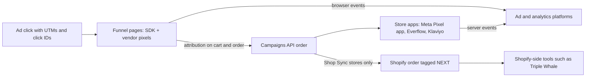

import { Callout } from 'fumadocs-ui/components/callout';

A NEXT Campaigns funnel is a set of your own pages (presell, landing, checkout, upsells, receipt) that load the Campaign Cart SDK and talk to the Campaigns API. Because the funnel is not a Shopify or storefront checkout, the tracking apps you may already use elsewhere do not see it automatically. This section explains what tracks a funnel today, how to set each platform up, and how to prove it works.

Start with [Set up tracking](/docs/campaigns/tracking/getting-started), then open the guide for your platform.

## How tracking works

Three parts can send tracking data for a campaign order. Each guide says which part it configures.

| Part | Where it runs | What it does | Where you configure it |
| --- | --- | --- | --- |
| Campaign Cart SDK | The shopper's browser | Captures UTM parameters and click IDs from the landing URL, emits an ecommerce event stream (`dl_*` events in `window.NextDataLayer`), and forwards it to GTM, the Meta pixel and RudderStack through built-in providers | `assets/config.js` (`window.nextConfig.analytics`) |
| Starter template analytics adapters | The shopper's browser | Load a vendor's pixel on every page and translate the SDK's `dl_*` events into that vendor's events: GA4, Triple Whale, TikTok, Northbeam, Snapchat, Pinterest, Taboola and AppLovin Axon | One key per vendor on the campaign entry in `_data/campaigns.json` |
| Store apps | NEXT's servers | Send order events server to server after the order exists. For campaign orders this covers the Meta Pixel app's Conversions API Purchase, Everflow postbacks and Klaviyo order events | The store dashboard, under **Apps** |

<Callout type="warn" title="Storefront tracking apps do not reach funnels">
The TikTok Pixel Events, Google Analytics 4, Google Tag Manager, AppLovin AXON and Taboola apps inject their scripts into your NEXT storefront only. They do not load on a campaign funnel. On a funnel, use the template adapters or the SDK providers instead. The Meta Pixel app is the exception for one event: its server-side Purchase is sent for campaign orders too.
</Callout>

## What happens at each step of a funnel

This is the behaviour of a starter template funnel on SDK 0.4.43 with the vendors turned on. It was checked with a test order on 2026-11-16.

| Step | What NEXT records | What the browser sends |
| --- | --- | --- |
| Shopper clicks your ad | The SDK stores `utm_source`, `utm_medium`, `utm_campaign`, `utm_content`, `utm_term`, `gclid`, `aff` or `affid`, `sub1` to `sub5` and `fbclid` from the landing URL for the browser tab session | Each vendor's page view |
| Presell and landing pages | Nothing new unless a parameter changes. A new value for a parameter replaces the old one | Page views; product views where a page shows packages |
| Checkout loads | The cart | `dl_begin_checkout` and the vendor's checkout-started event |
| Shopper types email or phone | A prospect cart once name, email and items are present | Triple Whale `Contact` (when turned on), and identity calls for vendors whose identity setting is on |
| Shipping and payment entered | | `dl_add_shipping_info`, `dl_add_payment_info` |
| Payment succeeds | The order, with the stored attribution (see [Events and attribution](/docs/campaigns/tracking/events-and-attribution)) | Nothing on the checkout page itself |
| First page after payment (upsell or receipt) | | `dl_purchase` with the order number as `transaction_id` and the item revenue as `value`. Shipping is never included; tax is excluded on stores that show prices without tax and included on stores that show tax-inclusive prices. Sent once per order; a reload or revisit does not send it again |
| Shopper accepts an upsell | The upsell line is added to the same order | `dl_upsell_purchase` on the next page, with `transaction_id` set to the order reference plus `-US1`, `-US2` and so on, and `value` set to the upsell line only |
| After the order | Store apps run server side: Meta Pixel app Purchase, Everflow postback, Klaviyo events. On Shop Sync stores the order is pushed to Shopify | |

Upsells reach each platform differently. Some count an accepted upsell as another purchase, some receive it as a separate custom event, and the SDK's Meta provider sends nothing for it. Each platform guide states which.

## Supported integrations

Each integration has two ratings. **Setup and events** says whether NEXT has confirmed the funnel sends the right events. **Platform reporting** says whether NEXT has confirmed the events arrive and report correctly inside the vendor's own dashboard.

- **Verified**: checked against the current source and observed in a test order.
- **Partial**: some of the path is verified and some is not, or it needs a workaround. The guide says which part.
- **Unconfirmed**: documented from source code or vendor documentation only. Treat it as untested.
- **Not supported**: no setup exists today.

| Integration | Setup and events | Platform reporting | Guide |
| --- | --- | --- | --- |
| Triple Whale | Verified | Unconfirmed; not supported on stores without Shopify | [Triple Whale](/docs/campaigns/tracking/triple-whale) |
| Meta pixel and Conversions API | Verified for browser events; server Purchase Unconfirmed | Unconfirmed | [Meta](/docs/campaigns/tracking/meta) |
| TikTok | Verified for browser events; no server event | Unconfirmed | [TikTok](/docs/campaigns/tracking/tiktok) |
| Google Ads and YouTube | Partial | Unconfirmed | [Google Ads and YouTube](/docs/campaigns/tracking/google-ads) |
| Google Analytics 4 | Verified | Unconfirmed | [Google Analytics 4](/docs/campaigns/tracking/google-analytics-4) |
| Google Tag Manager | Verified | Not applicable (your tags decide) | [Google Tag Manager](/docs/campaigns/tracking/google-tag-manager) |
| Northbeam, Snapchat, Pinterest, Taboola, AppLovin Axon, RudderStack, Everflow, Klaviyo | Unconfirmed | Unconfirmed | [More integrations](/docs/campaigns/tracking/more-integrations) |

Every guide opens with a **Verification status** table that lists exactly what was checked, how, on which SDK version and when.

## Send each purchase from one place

Every ad platform needs to receive a purchase once. A campaign order can reach a platform from up to three places: the funnel's browser pixel, a NEXT store app on the server, and, on Shop Sync stores, a Shopify-side app that reads the synced Shopify order. Decide which one sends the purchase for each platform before you launch.

- If the browser and the server both send it, they must share the same event ID so the platform can deduplicate. The Meta guide shows how NEXT does this for Meta.
- If a Shopify-side app also sends the synced order to the same platform, exclude orders tagged `NEXT` in that app, or block the purchase in the funnel.
- Meta deduplicates a browser and server event only when the event name and event ID match within 48 hours. Two server senders are never deduplicated.

[Tracking on Shop Sync stores](/docs/campaigns/tracking/shop-sync) has a table of which Shopify-side tools see synced orders.

## Privacy and consent

NEXT Campaigns has no built-in consent banner, consent mode, regional blocking or opt-out link. If your funnel needs them, build them into your pages and make sure they also stop the vendor scripts. The identity settings in the template adapters (for example `triplewhale_contact_enabled` and `meta_advanced_matching_enabled`) send the shopper's email and phone to that vendor. Turn them on only when your privacy policy and consent handling cover it. The SDK also stores the shopper's details in a first-party cookie and includes them in its `dl_*` events, so any tag you add in GTM can read them.

## Known gaps

These are the main limits today. Each guide lists its own.

- The SDK reads the Meta `_fbp` and `_fbc` cookies once when a page loads. On a first visit the Meta pixel may not have set them yet. The starter templates include a workaround; hand-built funnels do not.
- SDK 0.4.x does not store `ttclid`, `msclkid`, `gbraid` or `wbraid`. SDK 0.5.0 does.
- No NEXT app sends TikTok, Google Ads or Triple Whale events from the server for campaign orders.
- Triple Whale attributes an order only when it receives both a pixel purchase and a matching order record. On a store without Shopify, Triple Whale receives no order record.
- The template adapters are not packaged for hand-built funnels.

## Maintenance

This section is maintained by the NEXT Campaigns team. It is re-checked when a Campaign Cart SDK minor version is released, when the starter template analytics adapters change, and when the Meta Pixel app changes. Each page shows the date it was last verified.
